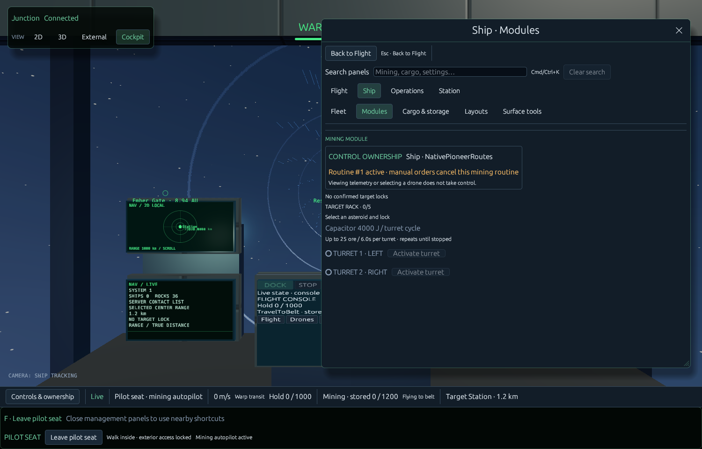

# Room interaction and Navigation availability checkpoint

The Airlock/EVA engineering panel now toggles confirmed commanded door intent, so interlocked pending open/close requests can be cancelled. It distinguishes requested and actual light, vent and door states. Both manual/powered paths retain existing typed commands, authority and interlocks; no new room simulation or range enforcement is claimed.

Navigation explanations now prioritize disconnection, pause and pending commands before stale telemetry, then missing vessel/on-foot ownership. Live freshness continues to gate commands; contacts/readouts remain available. During live .10 review, the paused world incorrectly showed only a freshness explanation; this corrects that cause without altering server behavior.

The previously failing strict visibility test exposed a theme regression: noninteractive weak_bg_fill was transparent, and egui uses this as its disabled-UI fade target. Transparent is the painter-invisible sentinel, so whole disabled groups disappeared. The target is now the opaque panel surface. A direct actual-text-shape regression and the unchanged strict range/Approach/no-dispatch assertions pass. No assertion was relaxed to hide missing controls.

Focused evidence: two room command/label checks; five Navigation/visibility/view-routing checks; one existing isolated native whole-client workspace review. No full suite repeated. Native pixels were inspected; disabled turret controls and Clear search now remain visible rather than vanishing.

This is a1500x960 actual native offscreen authority fixture, not a live user-world screenshot. Source receipt .build/logs/20261021T162500940152Z.json. It does not prove acoustic output or a completed flagship interior.

Physical cargo is still unactivated design work. The physical contract and functional room matrix record real systems, missing dependencies and compatibility hazards. Cargo/shared-adapter and Session-preview edits remain rejected/unapplied; earlier camera/walking/console/renderer boundaries remain unchanged. No world migration, quantity conversion, original asset edit or collision change.
