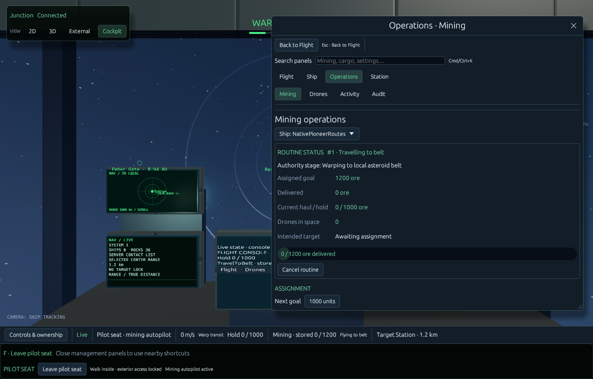
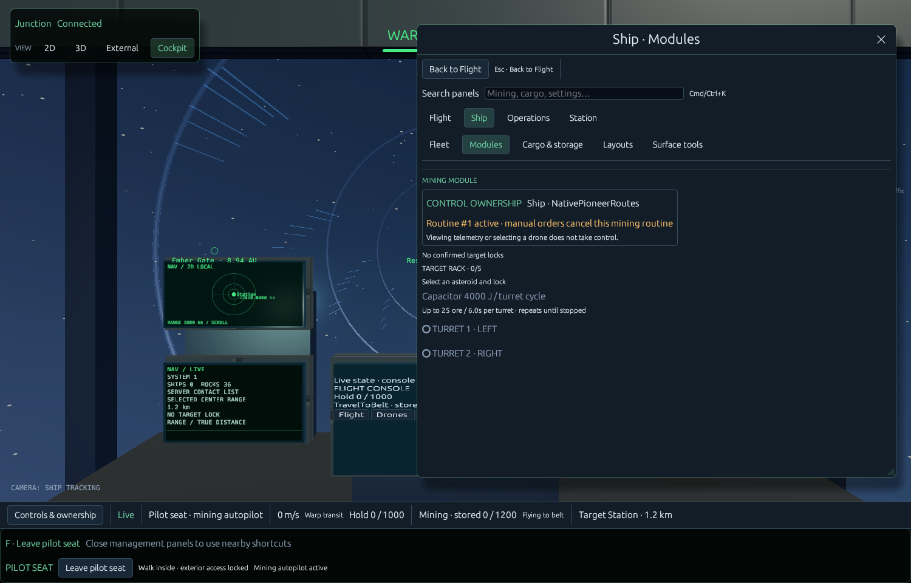
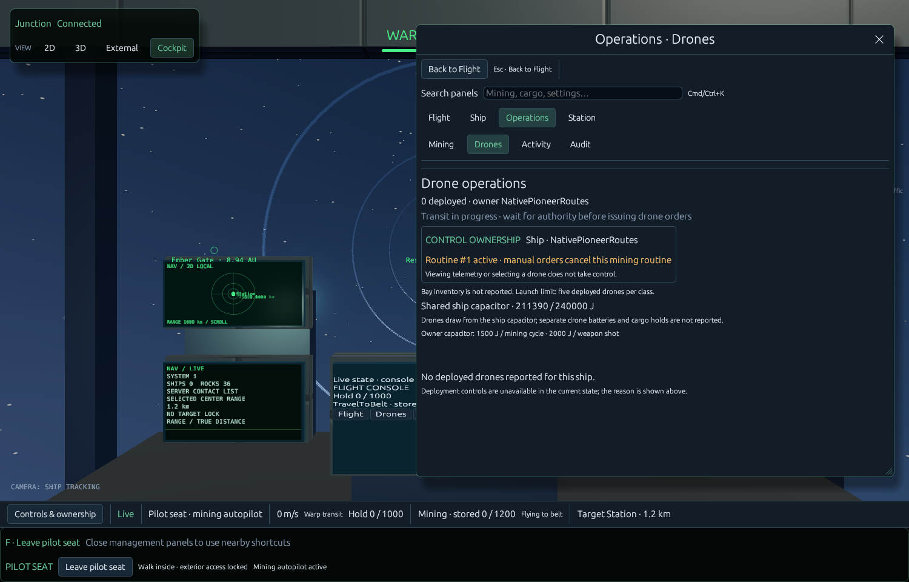

# Pioneer visual workspace checkpoint

The original UI now uses a graphite/navy surface hierarchy, consistent borders/focus/hover states and readable Heading22/Body15/Button14/Small12/Mono13 typography. Theme identities/preferences stay unchanged; no world material or lighting edits.

Persistent 2D,3D,External,Cockpit controls remain visible in a compact strip. On-foot First/Third selection is in the labeled Body control, with an explicit Return to body when observing the ship. Map options are progressively disclosed. Selecting a view releases prior input and never grants authority, moves the body or changes simulation mode. The status bar now uses live telemetry age rather than frozen visual time.

Overview searches actual local contact name/type/identity with clear/match counts, honest stale/no-results states and retained selection. Semantic pointer/focus IDs prevent sorted rows from selecting another object between press/release. Contact text now inherits readable theme type rather than fixed12px. Actual query focus uses existing text-input ownership guards; no new shortcut.

Native visual review exposed an unsupported Back arrow; the button now uses plain Back to Flight. Stream numbers in Sound make native reopen observable without treating callback statistics as proof of hearing.

## Actual engine images, kept locally

These are actual1500x960 native offscreen authority-fixture renders of implemented UI and existing ship geometry, not live user-world desktop captures or evidence of a new cargo mesh. The fixture's1200-unit goal is disposable, not the user's completed10000-unit job. Source fingerprints and fixture receipt accompany the pixels.

Focused checks cover contact search/reorder identity, selector layout at1280/3000logical widths, existing view non-mutation, workspace search/focus/back routing. Native whole-client captures of the three workspaces were inspected; no clipping in that fixture. Full-size desktop capture is currently limited by the OS thumbnail surface, so desktop acceptance is separately bounded.

## Remaining

Physical cockpit display typography/target-label overlap and full interior completion remain partial; shell polish does not establish that those are solved. The compatible cargo design is documented in [the interior program](ships/pioneer/interior-program-and-cargo-plan-20261021.md), but its multi-file source write was rejected before execution and remains unapplied. Session preview also remains rejected/unapplied. Existing camera, walking, console and renderer denial boundaries are unchanged. No uploads/publication.
