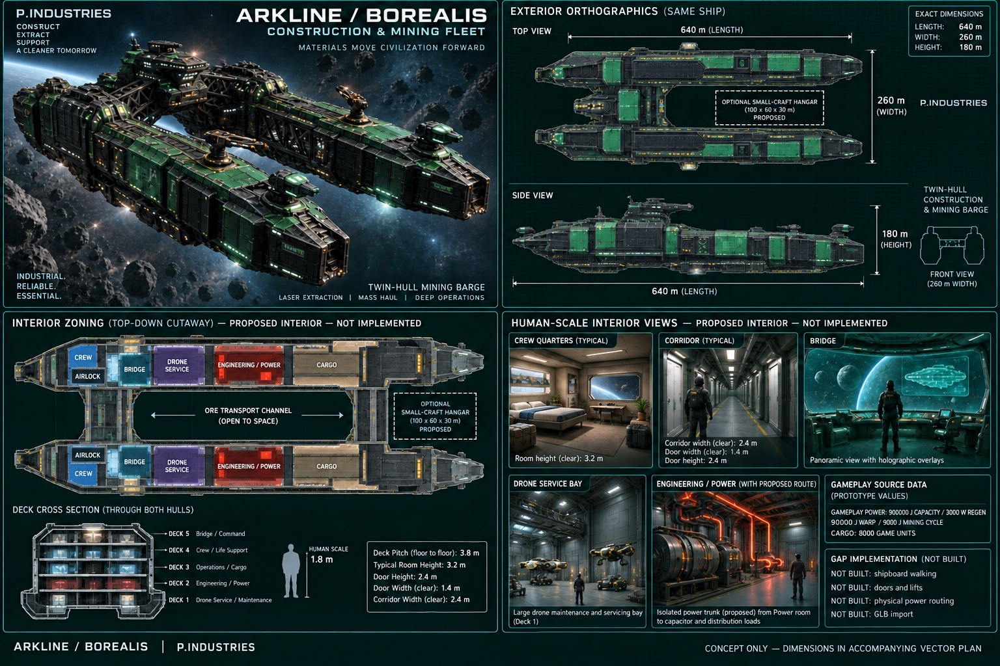
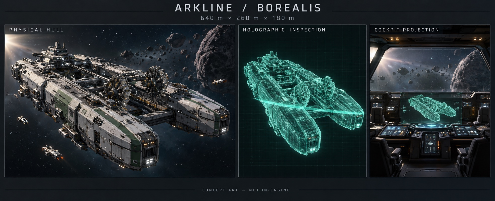
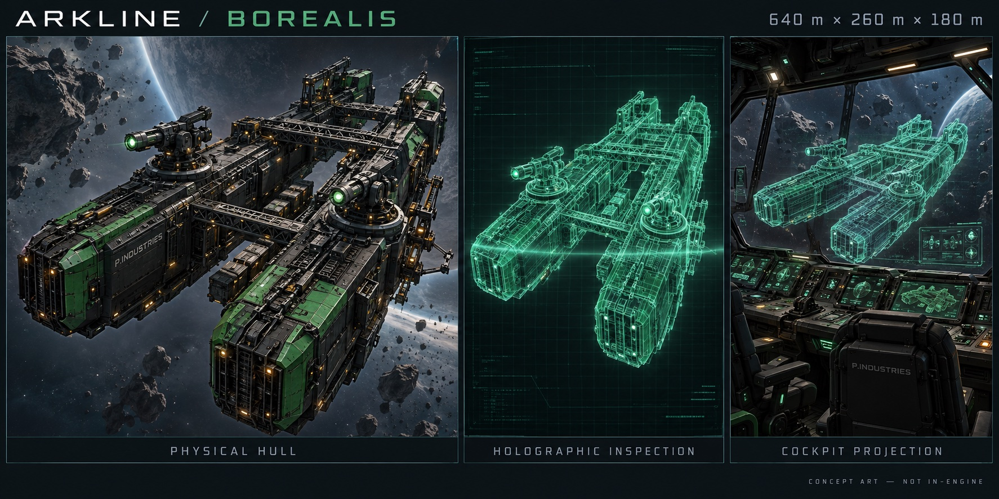
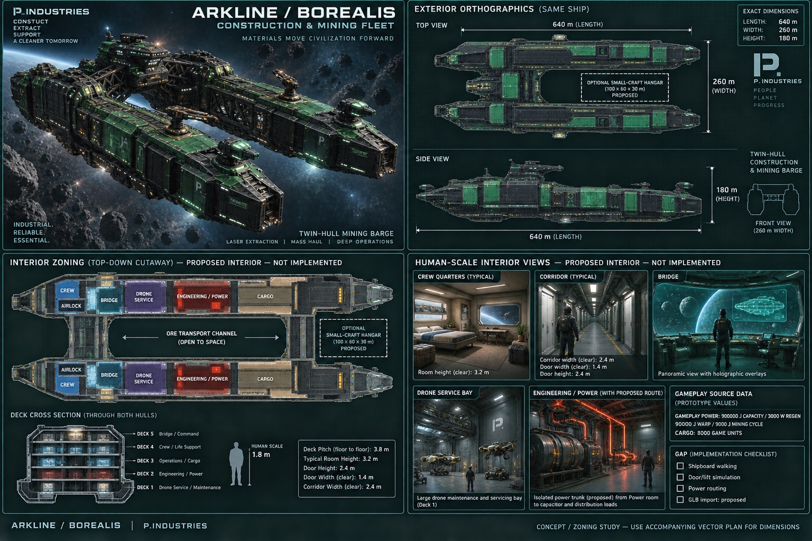

# Borealis — concept history

Design proposals only. The current review sheet is not a production mesh, exact hull CAD or implemented interior. Source values, dimensioned reservations and implementation gaps are linked below.

[Fleet index](../README.md) · [Dimensioned plan](plan.svg) · [Coordinates and source values](specification.json) · [Systems layout](systems.svg) · [Systems specification](systems.json)

## Current review

## Version history

Superseded images are retained for review. Early drafts include rejected pale hulls, drill-like equipment, invented brand marks, misleading checkboxes or inconsistent dimensions. Their annotations are not authoritative. The accepted direction is black/emerald industrial construction styling with articulated laser mining turrets.

### v01-initial-fleet

### v03-black-green-construction

### v04-interior-draft

## Provenance

Generated concept illustrations for this design discussion; not Tripo exports or third-party game assets. Repository JPEGs are compressed documentation previews of every original. The review ZIP contains the unmodified PNGs; image-manifest.json records their hashes. No executable game assets are supplied.
